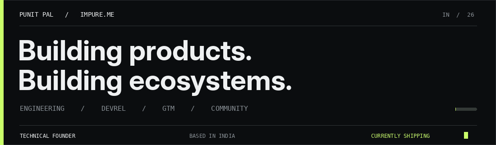
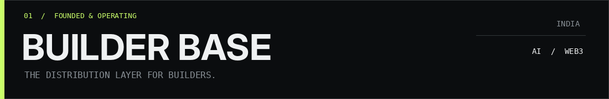

<div align="center">

<!-- Hand-designed animated banner (GIF) with a static fallback in assets/hero-preview.png -->


<br />

[](https://impure.me)
[](https://builderbase.xyz)
[](https://linkedin.com/in/punit05)
[](https://x.com/its_punit05)

<br />


**ENGINEERING × DEVREL × GTM × COMMUNITY**

<sub>Based in India · Building in public · Open to meaningful collaborations</sub>

</div>

---

### `01 / ABOUT`

I’m **Punit Pal**, a technical founder and builder working at the intersection of **AI, developer infrastructure, and onchain systems**. I enjoy both sides of building: shipping the product and creating the distribution that helps it reach people.

I founded **[Builder Base](https://builderbase.xyz)**, a builder-focused distribution and community initiative in India. Alongside community and ecosystem work, I build tools spanning **compilers, smart-contract developer experience, and multi-agent workflows**.

> **I don't just build products. I build the paths that help other builders ship.**

```yaml
punit_pal:
  identity: "Technical Founder / Engineer / Ecosystem Builder"
  focus: ["AI agents", "Developer tools", "Onchain infrastructure", "DevRel & GTM"]
  building: ["Builder Base", "PyVax", "FlowMon", "With Claude ecosystem"]
  community: "Distribution layer for builders in India"
  education: "B.Tech CSE (AI & Data Science), 2024–2028"
  philosophy: "Build useful things. Bring builders together. Create distribution."
```

### `02 / SELECTED WORK`

<table>
<tr>
<td width="50%" valign="top">

#### [FlowMon ↗](https://flow-mon.vercel.app/)
**Multi-agent orchestration · Monad**

Visual agent pipelines and orchestration workflows built for a Monad-native experience.

`AI Agents` `Workflows` `Monad`

**🏆 Monad Blitz V3 — hackathon win**

</td>
<td width="50%" valign="top">

#### [PyVax ↗](https://pyvax.xyz/)
**Python → EVM developer tooling**

A Python-first smart-contract toolchain targeting Avalanche, with an AST-based compilation pipeline and CLI workflow.

`Python` `Compilers` `Avalanche` `EVM`

[PyPI](https://pypi.org/project/pyvax/) · [Code](https://github.com/ShahiTechnovation/pyvax-rebrand)

</td>
</tr>
<tr>
<td width="50%" valign="top">

#### [Sol2Rust ↗](https://github.com/ShahiTechnovation/Sol2Rust)
**Solidity → Rust transpilation**

Compiler-oriented tooling that maps Solidity constructs into Rust for Arbitrum Stylus development.

`Solidity` `Rust` `Arbitrum Stylus`

**🥇 Core Nexus — 1st place**

</td>
<td width="50%" valign="top">

#### APV3RSE
**AI × Aptos / Move**

A project exploring AI-driven experiences in the Aptos and Move ecosystem.

`Aptos` `Move` `AI`

**🏅 Aptos Winter School — Top 15**

</td>
</tr>
<tr>
<td width="50%" valign="top">

#### [Zerothon ↗](https://zerothon.vercel.app/)
**Python × EVM browser IDE**

A playground for experimenting with Python-based smart-contract workflows and EVM networks.

`DevTools` `Web IDE` `EVM`

</td>
<td width="50%" valign="top">

#### [X4PN ↗](https://github.com/ShahiTechnovation/X4PN-UI)
**Decentralized VPN concept**

An onchain-oriented privacy and access product exploring USDC payments and token incentives.

`Web3` `Privacy` `USDC`

**🏅 FBI Hackathon — Top 10 finalist**

</td>
</tr>
</table>

<details>
<summary><b>More experiments & open-source work</b></summary>
<br />

- **[classified-agent](https://pypi.org/project/classified-agent/)**: LLM-powered agent layer associated with the PyVax ecosystem.
- **PyMon**: Python-oriented smart-contract development experiment for Monad.
- **NeuroFit**: AI-powered fitness project recognized at BrahmaX 1.0.
- **[With Claude projects](https://projects.withclaude.in/)**: Project discovery and community showcase infrastructure.

</details>

---

### `03 / BEYOND THE CODE`

<div align="center">

<a href="https://builderbase.xyz"></a>

</div>

**Founder, [Builder Base](https://builderbase.xyz)** — building a distribution layer connecting builders, products and ecosystems in India.

<table>
<tr>
<td align="center"><strong>64K+</strong><br/><sub>Luma audience*</sub></td>
<td align="center"><strong>70K+</strong><br/><sub>Newsletter reach*</sub></td>
<td align="center"><strong>Multiple cities</strong><br/><sub>India-wide activity</sub></td>
<td align="center"><strong>AI × Web3</strong><br/><sub>Developer ecosystems</sub></td>
</tr>
</table>

<sub>*Channel audience figures are directional snapshots, not unique people, and may overlap.</sub>

What I work on beyond writing code:

- **Developer relations:** technical workshops, developer onboarding, community activation and ecosystem programs.
- **GTM & distribution:** developer-first launches, partner campaigns, event-led growth and builder acquisition.
- **Community:** hackathons, meetups and build days across Delhi/NCR, Bhopal, Indore, Kolkata and beyond.
- **Partnerships:** connecting technology companies with high-intent builders and real product adoption.

**Selected initiatives:** [Hack in Hills](https://hackinhills.com/) · [With Claude](https://withclaude.in/) · Claude community workshops · Cerebras build events · [Builder Base events](https://luma.com/Builderbase)

<sub>Community involvement also includes TigerGraph city leadership and Avalanche Team1 contributions.</sub>

---

### `04 / RECOGNITION`

**5× hackathon winner / podium finisher** across AI and Web3 builder events (self-reported).

| Result | Event | Project |
| :-- | :-- | :-- |
| 🥇 **1st place** | Core Nexus, 2025 | [Sol2Rust](https://github.com/ShahiTechnovation/Sol2Rust) · Arbitrum Stylus |
| 🏆 **Winner** | Monad Blitz V3 | [FlowMon](https://flow-mon.vercel.app/) · Multi-agent orchestration |
| 🥈 **1st runner-up** | AVAX Kolkata / T1-Hack25, 2025 | [PyVax](https://pyvax.xyz/) |
| 🥈 **1st runner-up** | Monad Delhi, 2025 | PyMon |
| 🥈 **1st runner-up** | BrahmaX 1.0, 2025 | NeuroFit |

**Also:** Aptos Winter School **Top 15** (APV3RSE) · FBI Hackathon **Top 10 finalist** (X4PN).

---

### `05 / MY TOOLKIT`

**Languages:** Python · TypeScript · Rust · Solidity · JavaScript  
**Frameworks & tools:** React · Astro · Next.js · Node.js · FastAPI · Postgres · Foundry · Vercel


**Systems:** compiler pipelines, AST transformations, EVM/Move ecosystems, agent orchestration, developer tooling  
**Products:** React, Astro, Next.js, TypeScript, APIs, Postgres, serverless deployment  
**Builder growth:** DevRel, technical content, developer GTM, hackathons, partnerships, community operations

---

### `06 / GITHUB ACTIVITY`

<div align="center">

<picture>
<source srcset="https://github-readme-stats.vercel.app/api?username=ShahiTechnovation&show_icons=true&hide_border=true&theme=github_dark&rank_icon=github" media="(prefers-color-scheme: dark)" />
<source srcset="https://github-readme-stats.vercel.app/api?username=ShahiTechnovation&show_icons=true&hide_border=true&theme=default" media="(prefers-color-scheme: light)" />

</picture>


<br />

<picture>
  <source media="(prefers-color-scheme: dark)" srcset="https://raw.githubusercontent.com/ShahiTechnovation/ShahiTechnovation/output/github-snake-dark.svg" />
  <source media="(prefers-color-scheme: light)" srcset="https://raw.githubusercontent.com/ShahiTechnovation/ShahiTechnovation/output/github-snake.svg" />
  
</picture>

<sub>Snake animation requires the included GitHub Actions workflow to run once.</sub>

</div>

---

### `07 / LET'S BUILD SOMETHING`

I’m especially interested in **developer tools, AI-native products, infrastructure, DevRel, ecosystem growth, and ambitious builder communities**.

If you're shipping something builders should know about, let's talk.

<div align="center">

[](https://impure.me)
[](mailto:founder@builderbase.xyz)
[](https://x.com/its_punit05)
[](https://linkedin.com/in/punit05)

<br />

**BUILD PRODUCTS. ENABLE BUILDERS. CREATE DISTRIBUTION.**

<sub>Updated October 2026 · Delhi / India</sub>

</div>
